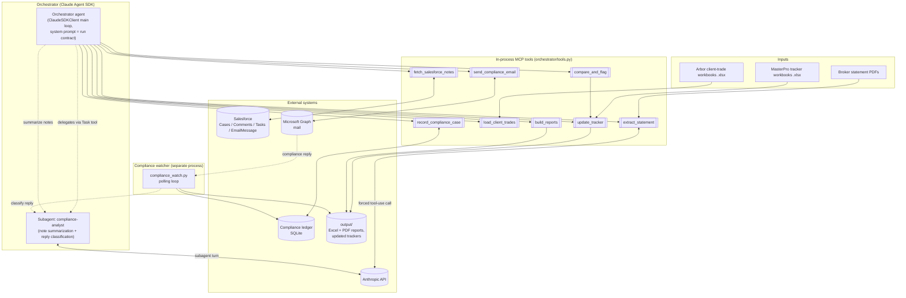
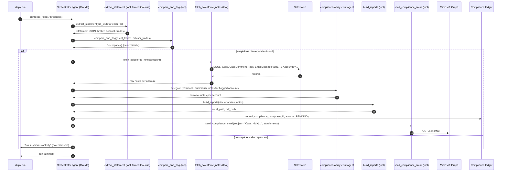
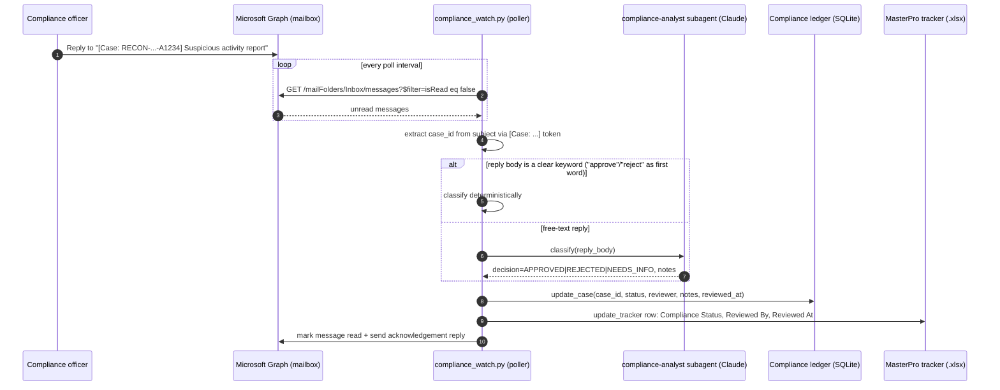

# Architecture: Claude Agent SDK Orchestrator

This replaces the previous design (Microsoft Agent Framework + Microsoft Foundry
Local for statement extraction) with an **agent orchestrator built on the
[Claude Agent SDK](https://code.claude.com/docs/en/agent-sdk/python)**. The
orchestrator coordinates specialized Claude agents and a set of deterministic
Python tools to run the monthly trade-reconciliation workflow end to end:
scan statements and client trades, compare them against advisor records and
tolerance metrics, pull Salesforce notes/comments for every flagged account,
generate Excel/PDF reports, email compliance, and close the loop when
compliance replies with a decision.

## Design principle: deterministic math, agentic judgment

Financial comparison logic must be reproducible and auditable, so it is never
delegated to an LLM. The split is:

| Concern | Owner | Why |
|---|---|---|
| Trade matching, price/qty/account comparison, tracker math | **Deterministic Python** (`orchestrator/compare.py`, `excel_io.py`) | Same input must always give the same output; must be unit-testable without network/API access |
| Reading unstructured PDF text into structured statements | **Claude, forced tool-use** (`extract_statement` tool, `orchestrator/extraction.py`) | Statement layouts vary by broker; this is a language-understanding task, but the output must validate against the `StatementList` schema every time, so the call forces a single structured tool response rather than free chat |
| Summarizing Salesforce notes/comments into a compliance-readable narrative | **Claude** (`compliance-analyst` subagent) | Free-text notes need synthesis, not computation |
| Classifying a compliance officer's free-text email reply (approve / reject / needs info) | **Claude** (`compliance-analyst` subagent) | Natural-language understanding of an arbitrary reply; same subagent, a different instruction |
| Sequencing the above and deciding what to do next | **Orchestrator agent** (`ClaudeSDKClient` main loop) | Ties the stages together, narrates progress, drafts the compliance email, delegates to `compliance-analyst` when judgment is needed |

The orchestrator's system prompt explicitly instructs Claude to treat every
tool's return value as ground truth and never recompute or restate numbers
differently from what a tool returned. Every deterministic tool
(`orchestrator/compare.py`, `orchestrator/excel_io.py`, `orchestrator/report.py`)
is plain Python with no SDK or network dependency, so it is unit-tested
directly without booting the agent loop or holding an Anthropic API key.

## Components

## Main run: sequence diagram

## Compliance approval loop: sequence diagram

## Data model

- `Trade`, `Statement`, `Discrepancy` — unchanged semantics from the previous
  deterministic pipeline (`orchestrator/models.py`).
- `SalesforceNote` — `{source, author, created_at, body}` normalized from
  `CaseComment`, `Task`, and `EmailMessage` records.
- `ComplianceCase` — `{case_id, run_id, account, status, created_at,
  reviewed_at, reviewer_email, decision_notes, report_paths, suspicious_count}`.
  `status ∈ {PENDING, APPROVED, REJECTED, NEEDS_INFO}`. Persisted in
  `output/compliance_ledger.sqlite3` (`orchestrator/ledger.py`), one row per
  flagged account per run, keyed by `case_id = RECON-<run_id>-<account>`.

## Why a case ID per account, not per run

A single email can cover several flagged accounts. Embedding the case ID in
the email subject (`[Case: RECON-20261030-143501-A1234]`) and keeping Graph's
`conversationId` lets compliance approve accounts independently and lets the
watcher match a reply to the exact case even if the subject line is edited by
a mail client, since the token is matched by regex anywhere in the subject.

## Deployment prerequisites

- Python 3.10+, Node.js 18+ (the Agent SDK drives the `@anthropic-ai/claude-code`
  CLI as a subprocess — `npm install -g @anthropic-ai/claude-code`).
- `ANTHROPIC_API_KEY` (or a Bedrock/Vertex-backed Claude Code auth profile).
- Entra app registration with Graph `Mail.Send` + `Mail.Read` application
  permissions (read is new — needed to poll for compliance replies).
- Salesforce connected app (OAuth2 client-credentials or JWT bearer) with read
  access to Account, Case, CaseComment, Task, EmailMessage.

See [DEPLOYMENT.md](./DEPLOYMENT.md) for step-by-step setup and
[dashboard.md](./dashboard.md) for the Streamlit GUI.
